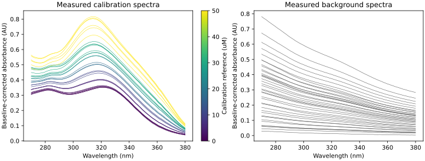
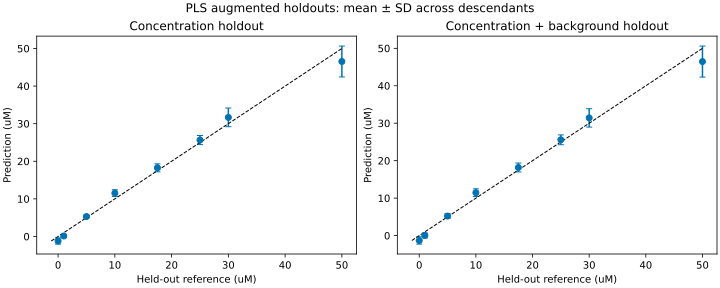
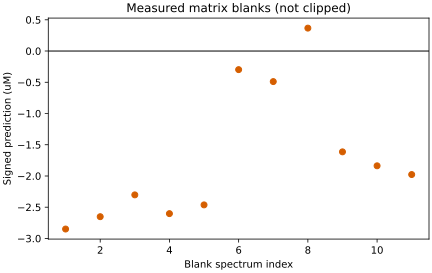

# UV-Vis spectral quantification

Quantifying a drug in a turbid nanoparticle supernatant requires separating
its absorption band from an interfering matrix. This project provides a
standalone partial least-squares (PLS) workflow and a measured talazoparib
case study in a polyvinyl-alcohol/double-emulsion matrix.

**Preliminary research software — work in progress.** This public version
provides a reproducible single-case workflow, not a finished or independently
validated analytical assay. APIs, documentation and results may evolve. It is
intended for research and reproducibility, not clinical or diagnostic use.
Software checks establish implementation consistency; they do not establish
accuracy on new matrices or samples.

## What is included

- A Python package independent of the thesis workspace and its path settings.
- Explicit baseline correction, wavelength-order validation and differentiation.
- Combinatorial augmentation of measured calibration and scattering spectra.
- A fixed two-component PLS model, two simple baselines and parent-aware holdouts.
- Measured matrix blanks with signed, unclipped concentration predictions.
- Input hashes, original sample mappings and source-producer parity checks.
- Unit/integration tests and a GitHub Actions reproduction workflow.

The initial case contains **30 measured calibration spectra**, **39 measured
background spectra**, and **68 measured observation spectra**, including 11
matrix blanks. Combining calibration and background parents at five scattering
amplitudes gives 5,850 training spectra. These are augmented observations, not
5,850 independent preparations.

## Quick start

Python 3.11 or later is required. From the repository root:

```bash
python -m venv .venv
# Linux/macOS: source .venv/bin/activate
# Windows PowerShell: .\.venv\Scripts\Activate.ps1
python -m pip install .
python -m unittest discover -s tests -v
spectral-quant --data data/talazoparib_nanode --output outputs/talazoparib_nanode
```

The module entry point is equivalent:

```bash
python -m spectral_quant.cli --data data/talazoparib_nanode --output outputs/talazoparib_nanode
```

Outputs include metrics, fold-level scores, predictions, augmentation lineage,
a serialized model and three diagnostic figures in SVG/PDF/PNG. Run artifacts
are ignored by Git; the reviewed numerical snapshot is in `reports/`.

## First measured case

| Fixed setting | Value |
| --- | --- |
| Drug / matrix | Talazoparib / double-emulsion supernatant |
| Concentration unit | micromolar (uM) |
| Absorbance unit | AU |
| Spectral window | 270-380 nm, inclusive, 1-nm spacing |
| Baseline | Median over 780-800 nm before cropping |
| Differentiation | Savitzky-Golay, 9 points, polynomial order 2, derivative 2 |
| PLS components | 2, fixed from the source producer |
| Scattering amplitudes | 0.5, 0.75, 1, 1.25, 1.5 |

If fewer than three baseline-tail points are present, preprocessing explicitly
uses the full-spectrum minimum, matching the source implementation. The bundled
case supplies the full axis. Prediction requires the exact calibrated grid:
there is no silent interpolation, amplitude normalization or negative clipping.

### Reproduced diagnostics

| Validation scheme | PLS RMSE (uM) | Single derivative wavelength RMSE (uM) | Training mean RMSE (uM) |
| --- | ---: | ---: | ---: |
| Leave one concentration out | 2.928 | 3.225 | 20.903 |
| Leave concentration and background fold out | 2.950 | 3.172 | 20.903 |

These pooled values mix two regions. Holding out the lowest (0 uM) or highest
(50 uM) calibration level is extrapolation; holding out any other level is
interpolation inside the calibrated range:

| Validation scheme | Region | PLS RMSE (uM) | Single derivative wavelength RMSE (uM) |
| --- | --- | ---: | ---: |
| Leave one concentration out | Interpolation (6 levels) | 1.922 | 2.295 |
| Leave one concentration out | Extrapolation (0, 50 uM) | 4.467 | 4.732 |
| Leave concentration and background fold out | Interpolation (6 levels) | 1.891 | 2.189 |
| Leave concentration and background fold out | Extrapolation (0, 50 uM) | 4.545 | 4.728 |

The pooled figure is dominated by the 50-uM endpoint. Per held-out level, PLS
has the lower RMSE at 5 of 8 levels; the single-wavelength baseline is lower at
0, 1 and 10 uM. `validation_by_fold.csv` and `metrics.json` carry the region.

The single-wavelength baseline chooses its wavelength using training data only.
It operates on the same differentiated window; it is not an optimized or
independently calibrated Beer-Lambert assay. The PLS advantage over this baseline
is modest in this case and is reported without a superiority significance test.

Matrix blank predictions are **-1.702 ± 1.086 uM** (mean ± sample SD, 11 measured
spectra). The nonzero signed bias is retained in the report rather than removed
by clipping or a post-hoc zero correction.







## What the validation measures

1. **Concentration holdout:** every calibration parent at one concentration is
   excluded before augmentation. The measured background library remains shared.
   This reproduces the original producer's leave-one-level-out diagnostic.
2. **Joint holdout:** those calibration parents and one of three background
   folds are excluded simultaneously. Neither parent type crosses the split.
   Background folds follow stable sample-ID order; they are not reconstructed
   synthesis or acquisition batches.
3. **Matrix blanks:** measured spectra provide a real-matrix bias diagnostic.
   They do not establish accuracy at positive unknown residual concentrations.

Both holdout schemes test augmented descendants, not new external preparations.
Endpoint folds are extrapolation; internal folds probe omitted levels inside
the calibration range. Components and preprocessing are fixed in this repository,
but they were chosen in prior work on these same data: the 270-380-nm window was
adopted because it brought these 11 matrix blanks close to zero, and the two
components were justified by this leave-one-level-out error and the same blanks.
Both are therefore development diagnostics, not independent checks of those
choices. The reported metrics are not an untouched external validation, a
validated assay LOQ, or proof of interlaboratory generalization.

Nonblank supernatants have an input nominal concentration, **not an independently
known residual concentration**. They are predicted, but not scored against the
input as if encapsulation had not occurred. Existing curation flags are retained
in metadata; this package does not discard those records or optimize exclusions.

## Use the model in Python

```python
from pathlib import Path
import pandas as pd
from spectral_quant import SpectralPLS

case = Path("data/talazoparib_nanode")
model = SpectralPLS().fit(
    pd.read_csv(case / "training_spectra.csv"),
    pd.read_csv(case / "training_metadata.csv"),
)
concentrations_uM = model.predict(pd.read_csv(case / "observation_spectra.csv"))
print(concentrations_uM.head())
```

Joblib models must only be loaded from trusted sources: deserialization may
execute code. The repository ships measured CSVs and code, not opaque model files.

## Repository layout

```text
src/spectral_quant/   preprocessing, calibration, validation and CLI
data/                measured spectra, metadata and SHA256 manifest
tests/               deterministic fixtures and measured-case integration test
reports/             reviewed metrics, figures and producer-parity snapshot
docs/                data schema, methods and release checklist
.github/workflows/   automated tests and case reproduction
```

See [data schema](docs/DATA_SCHEMA.md), [method and provenance](docs/METHODS.md)
and [release checklist](docs/RELEASE_CHECKLIST.md). `requirements-tested.txt`
records the numerical environment used for the local review; `pyproject.toml`
defines the broader installation requirements. Other environments must run the
tests, not assume bit-for-bit compatibility.

## Scope and rights

This first version covers one real single-analyte case. The thesis also contains
other matrices and dual-analyte models; they are not claimed to be reproduced by
this release. This repository does not modify or replace thesis results.

Code and accompanying documentation are available under the [MIT license](LICENSE).
Bundled measured spectra and metadata are available under [CC BY 4.0](data/LICENSE.md).
Please retain attribution, cite the repository and identify the commit used.
Third-party dependencies retain their own licenses. Public release and these
terms were authorized by the repository owner on 21 October 2026.

This preliminary release makes no claim of independent assay validation. New
matrices, external positive reference samples and interlaboratory performance
require further evaluation. No profile pinning or change to thesis results is
part of this release.
